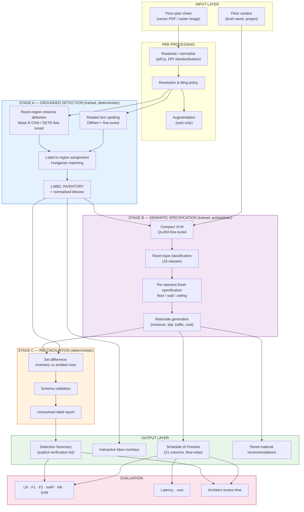
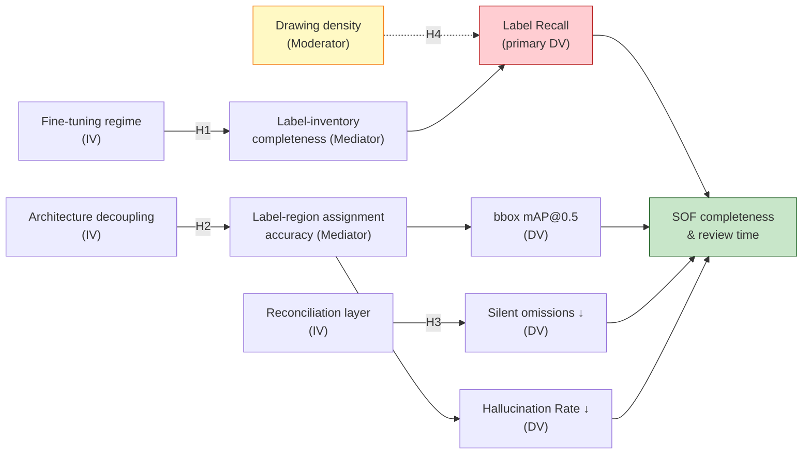
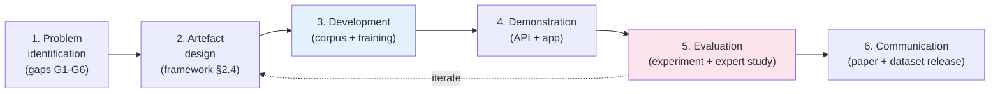
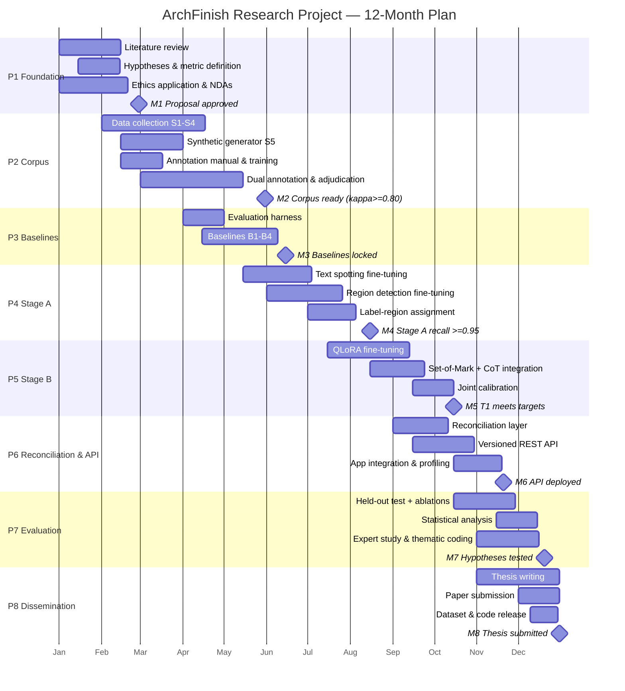
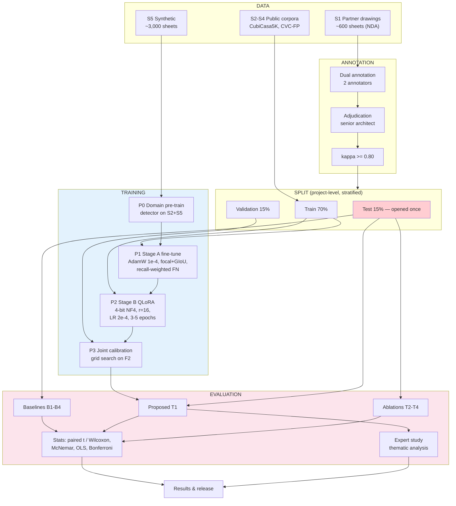

# Research Project Proposal

---

## 1. INTRODUCTION

### 1.1 Title of the Research

**Recall-Optimised Spatial Label Detection in Architectural Floor Plans: A Fine-Tuned Vision–Language Pipeline for Automated Schedule-of-Finishes Generation**

*Short title:* **ArchFinish — Exhaustive Room Detection and Finish Specification from Architectural Drawings**

| Element | Specification |
|---|---|
| **Primary domain** | Computer Vision, Document Image Analysis, Multimodal Machine Learning |
| **Application domain** | Architecture, Engineering & Construction (AEC) — interior finish specification |
| **Independent variables** | Model architecture, prompting/reasoning strategy, fine-tuning regime, input resolution, drawing density |
| **Dependent variables** | Label recall, room-level F1, bounding-box mAP, room-type accuracy, hallucination rate, inference latency, cost per sheet |
| **Control variables** | Drawing corpus, annotation protocol, hardware, evaluation splits |

---

### 1.2 Background of the Study

#### 1.2.1 Research Area

A **Schedule of Finishes (SOF)** is a tabular contract document that specifies, for every space in a building, the material, size, finish, product code, manufacturer and rate for flooring, skirting, dado, walls and ceiling. It is the authoritative reference for procurement, cost estimation, tendering and site execution. Producing an SOF requires an architect to read every labelled space on a floor plan and manually transcribe it into a spreadsheet row.

This research sits at the intersection of three areas:

1. **Document Image Analysis (DIA)** — extracting structure from engineering drawings.
2. **Object detection and semantic segmentation** — localising rooms as spatial regions.
3. **Multimodal (vision–language) reasoning** — mapping a detected space to a domain-appropriate material specification.

#### 1.2.2 Current Scenario

Floor-plan understanding has progressed through three generations:

- **Generation 1 — Rule-based / morphological (pre-2015).** Hand-crafted heuristics detect walls as thick parallel lines, then flood-fill enclosed regions. Brittle across drafting conventions and CAD templates.
- **Generation 2 — Supervised deep learning (2015–2021).** CNN detectors and segmentation networks (Faster R-CNN, Mask R-CNN, U-Net) trained on curated corpora such as CVC-FP, SESYD, ROBIN and CubiCasa5K. Strong on residential plans resembling training data; degrades on dense commercial sheets and unseen conventions.
- **Generation 3 — Large vision–language models (2022–present).** General-purpose VLMs (GPT-4V, Gemini, LLaVA) perform zero-shot drawing interpretation with no task-specific training, and can additionally *reason* about material suitability — something no CNN detector does. However they are non-deterministic, uninterpretable, produce hallucinated content, provide weak coordinate grounding, and incur recurring per-inference cost.

#### 1.2.3 A Working Baseline System

This proposal is grounded in a functional prototype (**ArchFinish**) already implemented by the researcher. It is a production web application that:

- Accepts a floor-plan image or PDF per building floor.
- Invokes a constrained vision–language model to extract every labelled space.
- Returns normalised bounding boxes that are rendered as interactive highlight overlays on the drawing.
- Auto-populates a 21-column Schedule of Finishes and exports it floor-wise to Excel and PDF.
- Generates per-room, per-element material recommendations with Budget / Standard / Premium alternatives.

Crucially, the prototype **is not a trained model** — it is a *prompt-engineered* pipeline over a proprietary foundation model. This distinction defines the research opportunity: the prototype establishes the task definition, the data schema, the evaluation harness and a measurable baseline, but the scientific contribution of this project is to replace zero-shot prompting with a **trained, reproducible, coordinate-grounded model**.

#### 1.2.4 Issues and Challenges

| # | Challenge | Description |
|---|---|---|
| C1 | **Recall of small service spaces** | Shafts, ducts, AHU rooms, electrical/meter rooms, lofts, niches and individual corridor segments are physically small, densely annotated and frequently missed. A single missed room propagates into a procurement shortfall. |
| C2 | **Label–region association** | A text label ("TOILET-2") must be bound to the correct enclosed polygon. Labels are often rotated, abbreviated, overlapping furniture, or placed outside their own room with a leader line. |
| C3 | **Duplicate-instance collapse** | Models tend to merge repeated spaces ("LIFT 1", "LIFT 2", "LIFT 3") into a single entity, silently under-counting. |
| C4 | **Weak coordinate grounding** | VLMs emit plausible but imprecise boxes; there is no geometric guarantee the box encloses the named room. |
| C5 | **Non-determinism and hallucination** | Identical input can yield differing output; models may invent rooms absent from the sheet. |
| C6 | **Absence of recall-focused benchmarks** | Existing floor-plan benchmarks optimise mIoU/mAP on residential plans. None measures *exhaustive label recall* on dense commercial sheets, which is the metric that actually matters for an SOF. |
| C7 | **Cost, latency and reproducibility** | Proprietary API dependence means recurring cost, version drift (model retirement), and non-reproducible research results. |

#### 1.2.5 Need for the Study

Manual SOF preparation for a mid-size commercial floor takes an experienced architect an estimated 4–8 hours and is error-prone precisely where errors are most expensive — omitted service spaces. Existing automated methods either (a) localise rooms but cannot specify finishes, or (b) specify finishes but cannot be trusted to find every room. **No published work treats exhaustive label recall as the primary optimisation target, nor closes the loop from detection through to a contract-ready, verifiable finish schedule.** This study addresses that gap with a trained, auditable, recall-first pipeline.

---

### 1.3 Significance of the Study

#### 1.3.1 Academic Value

- Introduces **Label Recall (LR)** and **Hallucination Rate (HR)** as first-class evaluation metrics for floor-plan understanding, complementing conventional mAP/mIoU.
- Delivers a publicly releasable **benchmark of dense commercial floor plans** annotated for exhaustive label inventory — a resource absent from the literature, which is dominated by residential corpora.
- Provides a controlled comparison of three paradigms (CNN detector, zero-shot VLM, fine-tuned hybrid) on an identical task and split, isolating the contribution of each component through ablation.
- Contributes an empirical study of **verification-augmented generation**: using deterministic post-hoc reconciliation to bound the failure modes of a probabilistic generator.

#### 1.3.2 Technical Value

- A reproducible, **open-weights** pipeline that removes dependence on a proprietary API, enabling offline and on-premise deployment (a hard requirement for confidential client drawings).
- A **two-stage architecture** that separates geometric grounding (trained detector, deterministic) from semantic reasoning (VLM, probabilistic), so each can be improved and audited independently.
- A documented, versioned **REST API** with a strict output schema, suitable for integration into BIM/CAD toolchains.

#### 1.3.3 Practical Value

- Reduces SOF preparation from hours to minutes, with the architect acting as reviewer rather than transcriber.
- The **Detection Summary** surfaces what the model could *not* resolve, converting silent omissions into an explicit verification checklist — the single most important safety property for contract documents.
- Material recommendations graded Budget / Standard / Premium support value-engineering conversations with clients.

#### 1.3.4 Beneficiaries

| Beneficiary | Benefit |
|---|---|
| Architects & interior designers | Eliminates manual transcription; reduces omission risk |
| Quantity surveyors / cost consultants | Faster, more complete bills of quantities |
| Contractors & procurement teams | Fewer mid-project material shortfalls from missed spaces |
| Clients / developers | Transparent, tiered cost options at specification stage |
| AEC-tech vendors & researchers | Open benchmark, metrics and baseline for future work |

#### 1.3.5 Contribution to Knowledge

The study advances the field from *"can a model segment a floor plan?"* to *"can a model be trusted to miss nothing, and prove it?"* — reframing floor-plan understanding as a **recall-critical, verification-bounded** problem rather than an accuracy-maximisation problem.

#### 1.3.6 Alignment with UN Sustainable Development Goals

| SDG | Alignment |
|---|---|
| **SDG 9** — Industry, Innovation and Infrastructure | Digitises and automates a core infrastructure-delivery workflow |
| **SDG 11** — Sustainable Cities and Communities | More accurate specification reduces construction rework and material waste |
| **SDG 12** — Responsible Consumption and Production | Tiered recommendations favour durable, low-maintenance materials; accurate quantities reduce over-ordering |
| **SDG 8** — Decent Work and Economic Growth | Shifts skilled professionals from clerical transcription to design judgement |
| **SDG 4** — Quality Education | Released dataset, metrics and code serve as teaching resources in AEC-AI curricula |

---

### 1.4 Aim, Objectives, Research Questions and Hypotheses

#### 1.4.1 Aim

> To design, train and empirically validate a recall-optimised vision–language pipeline that exhaustively detects and spatially grounds every labelled space in architectural floor plans, and generates a verifiable, contract-ready Schedule of Finishes — achieving measurably higher label recall than both supervised CNN detectors and zero-shot foundation models.

#### 1.4.2 Objectives

| ID | Objective | Measurable Deliverable |
|---|---|---|
| **O1** | Construct and annotate a benchmark corpus of architectural floor plans, emphasising dense commercial sheets, with exhaustive space-label ground truth, bounding boxes, room types and reference finish schedules. | ≥ 1,200 annotated sheets; inter-annotator agreement Cohen's κ ≥ 0.80 |
| **O2** | Establish quantitative baselines on this corpus for (a) a supervised CNN detector, (b) a zero-shot prompted VLM (the existing prototype). | Baseline LR, F1, mAP@0.5, HR, latency, cost reported per paradigm |
| **O3** | Design and train a two-stage hybrid pipeline: a fine-tuned text-spotting + region-detection front end, and a parameter-efficiently fine-tuned VLM back end for semantic typing and finish reasoning. | Trained checkpoints; documented training protocol; reproducible scripts |
| **O4** | Develop a deterministic reconciliation and verification layer that provably accounts for every detected label, reporting unresolved items rather than discarding them. | Reconciliation module; measured reduction in silent omissions |
| **O5** | Evaluate the pipeline against baselines and expose it through a documented, schema-validated REST API integrated into the ArchFinish application. | Comparative evaluation; ablation study; deployed versioned API |

#### 1.4.3 Research Questions

- **RQ1** *(→ O1, O2)* — What is the measurable label-recall deficit of current supervised detectors and zero-shot VLMs on dense commercial floor plans, and which categories of space are most frequently missed?
- **RQ2** *(→ O3)* — Does parameter-efficient fine-tuning of a compact open-weights VLM on domain-specific drawings achieve label recall equal to or greater than a substantially larger proprietary zero-shot model?
- **RQ3** *(→ O3)* — Does decoupling geometric grounding (trained detector) from semantic reasoning (VLM) yield higher bounding-box precision and lower hallucination than end-to-end VLM inference?
- **RQ4** *(→ O3)* — How do drawing density, input resolution and label rotation quantitatively affect recall, and where is the operating limit?
- **RQ5** *(→ O4, O5)* — To what extent does a deterministic reconciliation layer convert silent omissions into flagged, reviewable items, and what is its effect on end-to-end architect review time?

#### 1.4.4 Hypotheses

| ID | Hypothesis |
|---|---|
| **H1₀** | Fine-tuning a compact open-weights VLM on a domain corpus produces no significant improvement in label recall over zero-shot prompting of a larger proprietary model. |
| **H1₁** | Fine-tuning produces a statistically significant improvement in label recall (target: ≥ 8 percentage points, paired *t*-test / Wilcoxon signed-rank, α = 0.05). |
| **H2₀** | A decoupled two-stage architecture yields no significant improvement in bounding-box mAP@0.5 over end-to-end VLM inference. |
| **H2₁** | The decoupled architecture significantly improves mAP@0.5 (target: ≥ 0.15 absolute gain). |
| **H3₀** | Deterministic reconciliation does not significantly reduce the rate of silent omissions. |
| **H3₁** | Reconciliation significantly reduces silent omissions, surfacing ≥ 90 % of unmatched labels as explicit verification items. |
| **H4₀** | Drawing density has no significant effect on label recall. |
| **H4₁** | Label recall degrades significantly and monotonically with label density per unit sheet area (regression slope significantly < 0). |

---

## 2. LITERATURE AND RESEARCH FOUNDATION

### 2.1 Literature Review

#### 2.1.1 Floor-Plan Analysis: Datasets and Supervised Methods

**de las Heras et al. [1]** introduced **CVC-FP**, a structural floor-plan database with ground-truthed walls, doors, windows and rooms, together with the SGT groundtruthing tool. It established the evaluation conventions still used today but is modest in scale and residential in character.

**Liu et al. [2]** proposed **Raster-to-Vector**, converting rasterised floor plans into vector graphics by predicting junction primitives and solving an integer program for a consistent layout. It produces clean topology but assumes Manhattan geometry and relatively simple residential layouts — an assumption commercial plans (curved walls, angled cores, irregular service zones) violate.

**Kalervo et al. [3]** released **CubiCasa5K**, 5,000 annotated Finnish floor plans across 80 object categories, with a multi-task model jointly predicting room and icon segmentation. This is the largest widely used corpus, but it is (a) residential, (b) stylistically homogeneous, and (c) annotated for *room polygons*, not for exhaustive *text-label inventories*.

**Zeng et al. [4]** presented a **multi-task network with room-boundary-guided attention**, using predicted wall boundaries to condition room-type segmentation. Reported strong mIoU gains, confirming that boundary priors help — but the method is purely geometric and produces no textual or specification-level output.

**Key findings from this strand:** supervised methods achieve high mIoU *within distribution*, but (i) generalise poorly to unseen drafting conventions, (ii) target residential plans, and (iii) stop at geometry — they never reach material specification.

#### 2.1.2 Object Detection and Segmentation Backbones

**Ren et al. [5]** (**Faster R-CNN**) introduced the Region Proposal Network, making two-stage detection end-to-end trainable; still a strong baseline for small-object detection. **He et al. [6]** (**Mask R-CNN**) added a parallel mask branch for instance segmentation — directly relevant since rooms are instances, not just classes, and duplicate-instance collapse (C3) is an instance-separation failure. **Redmon et al. [7]** (**YOLO**) established single-stage real-time detection, trading some small-object accuracy for speed. **Carion et al. [8]** (**DETR**) reframed detection as set prediction with a transformer and bipartite (Hungarian) matching loss, eliminating anchors and NMS — its set-matching formulation is a natural fit for label→region association (C2). **Ronneberger et al. [9]** (**U-Net**) remains the canonical encoder–decoder for dense segmentation with limited training data.

**Limitation for this task:** all are closed-vocabulary and text-blind. They can find a *room-shaped region* but cannot read "AHU RM" and reason that it requires epoxy flooring.

#### 2.1.3 Text Detection and Document Understanding

**Xu et al. [10]** (**LayoutLM**) jointly pre-trained text and 2-D layout position, showing that spatial coordinates materially improve document understanding — direct evidence that label position should be an explicit model input rather than an afterthought. **Kim et al. [11]** (**Donut**) demonstrated OCR-free, end-to-end document understanding with a swin-transformer encoder and autoregressive decoder emitting structured JSON, removing cascading OCR error. **Liao et al. [12]** (**DBNet**) proposed differentiable binarisation for fast, accurate scene-text detection on arbitrarily shaped text — relevant because architectural labels are frequently rotated and sparse.

**Gap:** these target business documents (receipts, forms, invoices) with predictable reading order. Architectural drawings have no reading order, extreme aspect ratios, dense vector linework, and labels embedded inside graphical context.

#### 2.1.4 Vision–Language Models and Structured Output

**Dosovitskiy et al. [13]** (**ViT**) established transformers for image recognition at scale, the backbone of modern VLMs. **Liu et al. [14]** (**LLaVA**) showed visual instruction tuning can align a vision encoder to an LLM with modest compute — the methodological template for this project's fine-tuning stage. **Wei et al. [15]** (**chain-of-thought**) demonstrated that eliciting intermediate reasoning improves complex task performance; the prototype's three-phase prompt (transcribe → extract → reconcile) is a domain-specific application of this principle. **Yang et al. [16]** (**Set-of-Mark**) showed that overlaying explicit visual marks on an image substantially improves a VLM's spatial grounding — directly applicable to grounding room labels. **Hu et al. [17]** (**LoRA**) and **Dettmers et al. [18]** (**QLoRA**) made fine-tuning large models feasible on single-GPU budgets via low-rank adapters and 4-bit quantisation; QLoRA is the enabling technique for O3 under academic hardware constraints.

**Limitation:** VLM spatial grounding remains weaker than that of purpose-trained detectors, and outputs are non-deterministic — motivating the hybrid design of this proposal.

#### 2.1.5 Summary Comparison of Reviewed Work

| Ref. | Approach | Key Finding | Limitation for SOF Generation |
|---|---|---|---|
| [1] | Rule-based + groundtruth DB | Established FP evaluation conventions | Small scale; residential; no text inventory |
| [2] | Junction prediction + IP | Clean vector topology | Manhattan assumption; simple layouts |
| [3] | Multi-task CNN + 5K dataset | Largest public FP corpus | Residential; room polygons not label recall |
| [4] | Boundary-guided attention | Boundary priors raise mIoU | Geometry only; no specification output |
| [5][6] | Two-stage detection / instance seg. | Strong small-object & instance handling | Closed vocabulary; text-blind |
| [7] | Single-stage detection | Real-time inference | Weaker on small dense objects |
| [8] | Transformer set prediction | Hungarian matching removes NMS | Needs large data; slow convergence |
| [9] | Encoder–decoder segmentation | Effective with limited data | Semantic classes only, no instances |
| [10] | Layout-aware pre-training | 2-D position improves understanding | Business documents; assumes reading order |
| [11] | OCR-free structured extraction | Direct JSON output | Not validated on engineering drawings |
| [12] | Differentiable binarisation | Robust rotated text detection | Detection only, no semantics |
| [13][14] | ViT / visual instruction tuning | Scalable multimodal alignment | Weak fine-grained spatial grounding |
| [15][16] | CoT / Set-of-Mark prompting | Reasoning & marks improve grounding | Inference-time only; no weight learning |
| [17][18] | LoRA / QLoRA | Single-GPU fine-tuning feasible | Requires quality domain data |

---

### 2.2 Theories, Concepts and Existing Methodologies

#### 2.2.1 Underpinning Theories

| Theory / Principle | Relevance |
|---|---|
| **Statistical learning theory** (bias–variance, empirical risk minimisation) | Justifies fine-tuning: reducing domain shift between pre-training and the architectural-drawing distribution lowers empirical risk on the target task. |
| **Domain adaptation / transfer learning** | Core rationale for O3: a general VLM's representations transfer, but the task head and domain typography require adaptation. |
| **Information theory (recall–precision trade-off)** | Formalises the asymmetric cost structure: a false negative (missed room) is far costlier than a false positive (spurious row an architect deletes). Justifies recall-weighted objectives (Fβ, β > 1). |
| **Set prediction and optimal assignment (Hungarian algorithm)** | Theoretical basis for label→region association and for matching predictions to ground truth during evaluation. |
| **Cognitive load theory** | Motivates the interface design: the model handles exhaustive enumeration (high clerical load), the architect handles judgement (high expertise). |
| **Verification over trust (defence-in-depth)** | Underpins the reconciliation layer: a probabilistic generator is bounded by a deterministic checker, so failures surface rather than silently propagate. |

#### 2.2.2 Key Concepts and Operational Definitions

| Concept | Operational Definition |
|---|---|
| **Space label** | A text string on the drawing naming or tagging an enclosed space (e.g. "OPEN OFFICE (2)", "AHU", "LIFT 2100×2700"). |
| **Label inventory** | The complete set of space labels transcribed from a sheet, prior to any filtering. |
| **Room instance** | A labelled space realised as one row in the Schedule of Finishes, with a bounding box. |
| **Label Recall (LR)** | \|detected labels ∩ ground-truth labels\| ÷ \|ground-truth labels\| — the study's **primary metric**. |
| **Hallucination Rate (HR)** | Predicted rooms with no corresponding ground-truth label ÷ total predicted rooms. |
| **Silent omission** | A ground-truth label neither detected nor reported as unresolved — the most dangerous failure mode. |
| **Reconciliation yield** | Proportion of undetected/unmatched labels correctly surfaced as explicit verification items. |
| **Normalised bounding box** | `[y_min, x_min, y_max, x_max]` on a 0–1000 integer scale, resolution-independent. |
| **Building element** | One of `floor` \| `wall` \| `ceiling`, each receiving an independent finish specification. |
| **Drawing density** | Space labels per unit sheet area (labels / m² of drawn sheet), the key covariate for H4. |

#### 2.2.3 Existing Methodologies: Strengths and Limitations

| Methodology | Strengths | Limitations |
|---|---|---|
| **Morphological / rule-based** | Deterministic; interpretable; zero training data; fast | Brittle to convention changes; fails on dense/irregular plans |
| **CNN detection (Faster/Mask R-CNN, YOLO)** | Precise localisation; mature tooling; reproducible | Closed vocabulary; text-blind; needs large labelled corpus; poor OOD generalisation |
| **Semantic segmentation (U-Net, multi-task)** | Dense pixel-level room extents | Weak instance separation (duplicate collapse); no text/semantics |
| **Transformer set prediction (DETR)** | No anchors/NMS; elegant matching | Data-hungry; slow convergence; small-object weakness |
| **OCR + heuristic association** | Reads actual labels; modular | Cascading errors; leader-line and rotation failures |
| **Zero-shot VLM prompting** *(current prototype)* | No training data; reasons about materials; handles unseen conventions; rapid iteration | Non-deterministic; hallucinations; weak grounding; recurring cost; model-retirement drift; not reproducible |
| **Fine-tuned VLM (LoRA/QLoRA)** *(proposed)* | Domain-adapted; open weights; reproducible; on-premise; deterministic at T→0 | Requires curated annotated corpus; GPU cost; risk of overfitting to corpus style |

---

### 2.3 Research Gap

#### 2.3.1 What Previous Work Has Established

Prior work has convincingly demonstrated that (i) floor-plan rooms can be segmented with high mIoU within distribution [3][4], (ii) vectorised topology can be recovered for simple residential layouts [2], (iii) layout-aware and OCR-free architectures extract structured data from documents [10][11], and (iv) large VLMs interpret unseen drawing conventions zero-shot and can reason about domain semantics [14][16].

#### 2.3.2 Identified Gaps

| Gap | Description | Addressed by |
|---|---|---|
| **G1 — Recall is not the optimisation target** | Every reviewed benchmark reports mIoU/mAP/accuracy. None reports exhaustive *label recall*, despite a single missed room invalidating a contract document. | O1, O2 (metric + benchmark) |
| **G2 — Residential bias in corpora** | CVC-FP, CubiCasa5K, SESYD, ROBIN are overwhelmingly residential and stylistically narrow. Dense commercial sheets — with AHU rooms, shafts, ducts, lift banks, multiple numbered toilets — are effectively absent. | O1 (commercial corpus) |
| **G3 — Geometry–semantics disconnect** | Detectors produce regions without specifications; VLMs produce specifications with unreliable regions. No published pipeline delivers both a trustworthy region *and* a justified material specification. | O3 (two-stage hybrid) |
| **G4 — Unbounded generative failure** | Zero-shot VLM pipelines (including the researcher's own prototype) provide no mechanism to prove completeness; omissions are silent. | O4 (reconciliation layer) |
| **G5 — Reproducibility deficit** | Proprietary-API-based results are not reproducible: models are retired and versions drift. During prototype development a previously working model was withdrawn mid-project, breaking inference — a concrete manifestation of this risk. | O3 (open weights), O5 (versioned API) |
| **G6 — No end-to-end evaluation to the deliverable** | Work is evaluated on intermediate proxies (mIoU), never on the artefact practitioners need (a correct, complete SOF) or on human review effort. | O5 (end-to-end + human-in-loop evaluation) |

#### 2.3.3 Proposed Gap Solution

This study proposes a **recall-first, verification-bounded, two-stage trained pipeline**:

1. **Stage A — Grounded detection (deterministic, trained).** Fine-tuned rotated-text spotting produces the label inventory; a fine-tuned instance detector produces candidate room regions; Hungarian assignment binds labels to regions. This directly attacks G1, G2, G3.
2. **Stage B — Semantic specification (probabilistic, trained).** A QLoRA-fine-tuned compact VLM consumes each grounded region plus its label and emits room type and per-element finish specification with rationale. Open weights address G5.
3. **Stage C — Reconciliation (deterministic, non-negotiable).** Every inventory item must terminate in either an SOF row or an explicit "requires verification" entry. Set difference between inventory and emitted rows can never be silently discarded. This addresses G4.
4. **Stage D — Evaluation to the deliverable.** Measured on label recall, SOF row-level completeness and architect review time, not only mIoU. This addresses G6.

---

### 2.4 Research Framework / Conceptual Framework

#### 2.4.1 Variables

| Type | Variable | Operationalisation |
|---|---|---|
| **Independent** | Model paradigm | {CNN detector, zero-shot VLM, fine-tuned hybrid} |
| **Independent** | Fine-tuning regime | {none, LoRA r=8, LoRA r=16, QLoRA 4-bit} |
| **Independent** | Reasoning strategy | {direct, chain-of-thought 3-phase, CoT + Set-of-Mark} |
| **Independent** | Input resolution | {1024, 1536, 2048, tiled} px longest edge |
| **Moderating** | Drawing density | labels per m² of sheet (low / medium / high tercile) |
| **Moderating** | Drawing provenance | {CAD-native vector PDF, scanned raster, exported image} |
| **Mediating** | Label-inventory completeness | LR of Stage A alone |
| **Mediating** | Label–region assignment accuracy | proportion of labels bound to correct polygon |
| **Dependent** | Label Recall (primary) | as defined in §2.2.2 |
| **Dependent** | Room-level Precision / Recall / F1, F2 | standard, with β=2 recall weighting |
| **Dependent** | Bounding-box mAP@0.5, mAP@[.5:.95] | COCO protocol |
| **Dependent** | Room-type accuracy | 16-class classification accuracy |
| **Dependent** | Hallucination Rate | as defined in §2.2.2 |
| **Dependent** | Schema Validity Rate | % outputs passing strict JSON-schema validation |
| **Dependent** | Latency (p50/p95), cost per sheet | seconds; INR per sheet |
| **Dependent** | Architect review time | minutes to verified SOF (human-in-loop study) |
| **Control** | Corpus, splits, annotation protocol, seed, hardware | fixed across conditions |

#### 2.4.2 Framework Diagram



#### 2.4.3 Hypothesised Relationships



#### 2.4.4 Framework Explanation

The framework encodes the study's central design claim: **grounding and meaning should be learned separately and joined deterministically.**

- **Stage A** is optimised purely for *recall of labels and regions*. It is permitted to over-produce candidates, because Stage C can surface ambiguity, whereas nothing can recover a label never detected. This is where H1 and H4 are tested.
- **Stage B** performs no localisation. It receives an already-grounded region and its label, so its hallucination surface is structurally reduced — it cannot invent a room because it never proposes rooms. This is where H2 is tested.
- **Stage C** is the safety property. It is deterministic set arithmetic, not a model, which is precisely why it can be trusted to bound the probabilistic components. This is where H3 is tested.
- **Drawing density** moderates the entire chain and is measured explicitly rather than averaged away, because the practical question "can I trust this on a dense commercial sheet?" is exactly the question the literature leaves unanswered (G2).

---

## 3. RESEARCH PROBLEM AND DESIGN

### 3.1 Research Problem

#### 3.1.1 Problem Statement

> Automated floor-plan interpretation systems cannot currently guarantee — or even measure — that they have detected **every** labelled space on an architectural drawing. Supervised detectors are text-blind and residential-biased; zero-shot vision–language models read labels but omit spaces silently, hallucinate others, and ground coordinates unreliably. Because a Schedule of Finishes is a contract document, a single undetected space (a shaft, an AHU room, the third of three identical lifts) propagates into procurement shortfalls and site rework. **There exists no trained, reproducible pipeline that optimises for exhaustive label recall and proves completeness by construction.**

#### 3.1.2 The Specific Issue to be Investigated

Whether **domain-specific supervised training, combined with architectural decoupling of grounding from semantics and a deterministic reconciliation guarantee**, can raise label recall on dense commercial floor plans above both supervised-detector and zero-shot-VLM baselines — while eliminating silent omissions and removing proprietary-API dependence.

#### 3.1.3 Key Variables

- **Manipulated:** model paradigm, fine-tuning regime, architectural decoupling (one-stage vs two-stage), reasoning strategy, input resolution.
- **Measured:** Label Recall (primary), F1/F2, bbox mAP, room-type accuracy, Hallucination Rate, Schema Validity Rate, silent-omission count, latency, cost, architect review time.
- **Moderating:** drawing density, drawing provenance (vector vs scanned).

#### 3.1.4 Existing Deficiency (Empirically Observed)

The researcher's working prototype exposes the deficiency concretely. It reports, per sheet, a label inventory count alongside the number of rooms actually written to the schedule, and computes the set difference server-side. Observed behaviours during development include:

- Labels transcribed but not converted into schedule rows (requiring a reconciliation warning to avoid silent loss).
- Truncated generation on dense sheets when the output token ceiling was reached mid-array, necessitating a JSON-repair routine to salvage partial results.
- A dependency model being **retired by the provider mid-project**, causing total inference failure until the model identifier was changed — demonstrating the reproducibility risk (G5) in practice.
- No mechanism to verify bounding-box correctness beyond visual inspection.

These are not implementation bugs; they are structural properties of unconstrained zero-shot generation, and they motivate the trained, bounded design proposed here.

#### 3.1.5 Impact of the Problem

| Dimension | Impact |
|---|---|
| **Economic** | Missed spaces cause under-ordering, variation orders and rework; errors discovered on site cost multiples of errors caught at specification. |
| **Professional** | Architects cannot delegate to a tool whose completeness is unverifiable, so the technology is not adopted. |
| **Scientific** | Without a recall benchmark on commercial plans, the field cannot measure progress on the failure mode that matters most. |
| **Sustainability** | Specification errors drive material waste and rework emissions (SDG 11, 12). |

---

### 3.2 Research Approach

#### 3.2.1 Selected Approach: **Mixed Methods (Quantitative-Dominant, QUANT → qual)**

| Component | Weight | Role |
|---|---|---|
| **Quantitative** (dominant) | ~80 % | Controlled model comparison, hypothesis testing (H1–H4), ablation studies, performance benchmarking |
| **Qualitative** (supporting) | ~20 % | Expert review with practising architects: error-mode taxonomy, interpretability of AI rationales, trust and usability of the Detection Summary |

#### 3.2.2 Justification

1. **Quantitative dominance is required** because the core claims (H1–H4) are comparative and numeric: recall deltas, mAP gains, omission reductions. These demand controlled experiments on fixed splits with inferential statistics.
2. **A purely quantitative design would be insufficient** because two research questions concern human factors: *which* categories of space get missed and *why* (RQ1), and whether reconciliation output actually reduces review effort and earns practitioner trust (RQ5). Aggregate metrics cannot explain failure modes or perceived reliability.
3. **Sequential explanatory design** (QUANT then qual) is appropriate: quantitative results identify *where* the model fails, and subsequent expert interviews explain *why* those failures occur and whether the surfaced warnings are actionable.
4. **Triangulation** across automatic metrics, ground-truth comparison and expert judgement strengthens validity for a domain where the deliverable is a professional contract document, not merely a benchmark score.

---

### 3.3 Research Design

#### 3.3.1 Selected Design: **Development Research (Design-Science) with an Embedded Controlled Experiment**

The study follows a **Design Science Research (DSR)** cycle — problem identification → artefact design → development → demonstration → evaluation → communication — with a **controlled comparative experiment** embedded at the evaluation stage, supplemented by a **human-in-the-loop usability study**.



#### 3.3.2 Experimental Structure

**Design type:** Within-subjects (repeated measures) — every model condition is evaluated on the *identical* held-out test set, so sheet difficulty is controlled by design rather than randomisation.

**Conditions (independent variable = model paradigm):**

| ID | Condition | Description |
|---|---|---|
| **B1** | Rule-based baseline | Morphological wall detection + flood fill + off-the-shelf OCR |
| **B2** | Supervised CNN | Mask R-CNN fine-tuned on the corpus (text-blind) |
| **B3** | CNN + OCR heuristic | B2 plus OCR and nearest-centroid label association |
| **B4** | Zero-shot VLM *(current prototype)* | Constrained schema + 3-phase CoT prompt, no weight updates |
| **T1** | **Proposed: two-stage fine-tuned hybrid** | Stage A (fine-tuned spotting + detection + Hungarian) → Stage B (QLoRA VLM) → Stage C (reconciliation) |
| **T2** | Ablation: T1 without reconciliation | Isolates H3 |
| **T3** | Ablation: T1 end-to-end (single-stage VLM, fine-tuned) | Isolates H2 (decoupling effect) |
| **T4** | Ablation: T1 without Set-of-Mark grounding | Isolates grounding-aid contribution |

**Data splits:** stratified by drawing density tercile and provenance — **70 % train / 15 % validation / 15 % test**, split at *project* level (not sheet level) to prevent leakage between floors of the same building.

**Statistical treatment:** paired *t*-test where normality holds (Shapiro–Wilk), otherwise Wilcoxon signed-rank; Bonferroni correction for multiple comparisons; effect size via Cohen's *d*; 95 % bootstrap confidence intervals (10,000 resamples) on all reported metrics; ordinary-least-squares regression of LR on density for H4.

#### 3.3.3 Justification of Design

| Requirement | Why this design satisfies it |
|---|---|
| Must produce a usable artefact, not only findings | DSR is the established paradigm for research whose output is an engineered system |
| Must support causal claims about components | Embedded controlled experiment with ablations isolates each contribution |
| Must control for sheet difficulty | Within-subjects evaluation on a common test set removes between-group variance |
| Must avoid optimistic leakage | Project-level splitting prevents same-building floors appearing across splits |
| Must explain failures, not just count them | Embedded qualitative expert study provides the explanatory layer |
| Must be reproducible | Open weights, fixed seeds, released splits, versioned API |

#### 3.3.4 Validity and Threats

| Threat | Type | Mitigation |
|---|---|---|
| Data leakage between floors of one building | Internal | Project-level splitting |
| Annotator bias / inconsistency | Construct | Dual independent annotation; Cohen's κ ≥ 0.80; adjudication protocol |
| Overfitting to one drafting style | External | Multi-firm sourcing + public corpora; provenance stratification; cross-firm holdout |
| Proprietary-model version drift during study | Internal | Pin model identifier + record inference date; report as documented limitation |
| Metric gaming (recall inflation via over-production) | Construct | Always report precision and HR alongside LR; use F2 as balanced summary |
| Expert reviewer expectancy effects | Internal | Blind condition labels; randomise presentation order |
| Small expert sample | External | Report as limitation; use expert study for explanation, not generalisation |

---

### 3.4 Scope of the Research

#### 3.4.1 In Scope

| Dimension | Inclusion |
|---|---|
| **Drawing types** | 2-D architectural floor plans and furniture-layout plans |
| **Sheet formats** | CAD-exported vector PDF, scanned raster PDF, PNG/JPG/WEBP/TIFF |
| **Building typologies** | Commercial offices (primary focus), institutional, hospitality, multi-family residential |
| **Spatial granularity** | Labelled enclosed spaces, including service spaces (shafts, ducts, AHU, electrical, pump, lift cores, staircases, corridor segments) |
| **Building elements** | Flooring, skirting, dado, walls, ceiling |
| **Output** | 21-column Schedule of Finishes, normalised bounding boxes, tiered material recommendations, verification summary |
| **Languages** | English-labelled drawings (Indian AEC convention) |
| **Deployment target** | Web application with documented REST API; on-premise-capable open-weights inference |
| **Multi-floor** | Project-level organisation with per-floor schedules and combined project export |

#### 3.4.2 Population and Sampling

- **Target population:** architectural floor-plan sheets produced by professional practices for building projects.
- **Sampling frame:** (a) drawings contributed under NDA by 3–5 collaborating architecture/interior-design practices; (b) public corpora — CubiCasa5K [3], CVC-FP [1], and other openly licensed floor-plan datasets.
- **Sampling strategy:** purposive stratified sampling across drawing density (terciles), building typology and provenance (vector vs scanned), to ensure dense commercial sheets — the under-represented case in the literature — are adequately represented.
- **Target size:** ≥ 1,200 annotated sheets; ≥ 25,000 annotated space instances. Minimum viable: 600 sheets (contingency in §5.1).

#### 3.4.3 Conditions and Assumptions

- Drawings are legible at ≥ 150 DPI equivalent and are architecturally complete (not conceptual sketches).
- Space labels are present as text (typed or clearly hand-lettered); fully unlabelled plans are out of scope for *label* recall, though region detection still applies.
- Ground-truth finish schedules, where used for Stage B supervision, are those authored by the originating practice and treated as reference (not absolute) standards.
- Material rates reflect the Indian market at the time of collection and are indicative, not authoritative.

#### 3.4.4 Applications

Specification automation, automated quantity take-off support, design QA/completeness auditing, BIM data enrichment, and AEC-education tooling.

#### 3.4.5 Explicit Exclusions

| Excluded | Rationale |
|---|---|
| 3-D models, IFC/BIM-native parsing, point clouds | Different input modality; this study targets 2-D drawing interpretation |
| Structural, MEP, plumbing and electrical drawings | Different symbol vocabularies and schedule semantics |
| Elevations, sections, detail drawings | Non-planar; no room enclosure to detect (classified and skipped, not analysed) |
| Automated cost estimation / BOQ pricing | Requires live commercial rate feeds; out of scope beyond indicative rates |
| Non-English drawing annotations | Requires multilingual typography corpus; noted as future work |
| Full structural / code-compliance checking | Regulatory scope beyond finish specification |
| Hand-drawn conceptual sketches | Insufficient labelling regularity |
| Clinical claims about human performance | The human-in-loop study is exploratory, not a powered RCT |

---

## 4. RESEARCH IMPLEMENTATION AND EVALUATION

### 4.1 Data Collection

#### 4.1.1 Data Sources

| Source | Type | Description | Target Volume |
|---|---|---|---|
| **S1 — Partner practices** | Primary | Real project drawings + their authored Schedules of Finishes, contributed under NDA by 3–5 architecture/interior practices. Highest value: dense commercial sheets with matched ground-truth schedules. | ~600 sheets |
| **S2 — CubiCasa5K** [3] | Secondary | 5,000 annotated residential floor plans; used for pre-training Stage A region detection and for out-of-distribution generalisation testing. | 5,000 sheets (subsampled) |
| **S3 — CVC-FP** [1] | Secondary | Structurally ground-truthed floor plans with walls/doors/windows/rooms. | ~120 sheets |
| **S4 — Public tender / municipal filings** | Secondary | Openly published building-permit drawings (licence-checked per jurisdiction). | ~300 sheets |
| **S5 — Synthetic generation** | Primary (generated) | Procedurally generated plans with programmatic ground truth: randomised layouts, label typography, rotation, line weights, drafting conventions. Guarantees perfect labels and lets density be controlled as an experimental factor. | ~3,000 sheets |
| **S6 — Expert review sessions** | Primary (qualitative) | Semi-structured interviews + think-aloud with 8–12 practising architects reviewing model output. | 8–12 participants |

#### 4.1.2 Primary vs Secondary Data

- **Primary:** S1 (real drawings + reference schedules), S5 (synthetic corpus authored for this study), S6 (expert qualitative data).
- **Secondary:** S2, S3, S4 (existing published/licensed corpora).

#### 4.1.3 Annotation Protocol

Each sheet receives:

1. **Label inventory** — every space-naming text string, transcribed verbatim (preserving numbering and abbreviation, e.g. `TOILET-2`, `LIFT 2100×2700 (3)`).
2. **Bounding box** per space — normalised `[y_min, x_min, y_max, x_max]` on a 0–1000 integer scale.
3. **Room type** — one of 16 classes (`bedroom, bathroom, kitchen, living, dining, hallway, utility, office, storage, balcony, garage, lobby, staircase, parking, service, general`).
4. **Space tag** — room number/code where present.
5. **Reference finish specification** — from the practice's own SOF where available (S1 only).
6. **Sheet metadata** — provenance, DPI, drawn area, computed label density, floor level.

**Quality control:**

- Two annotators label each sheet independently; a third (senior architect) adjudicates disagreements.
- Agreement targets: **Cohen's κ ≥ 0.80** for room type; **IoU ≥ 0.75** for box agreement; **exact-match ≥ 0.95** for label strings after case/whitespace normalisation.
- A written annotation manual with worked examples of the hard cases (leader lines, rotated text, duplicate numbering, labels outside their room) is version-controlled.
- 10 % of sheets are re-annotated after a 4-week interval to measure intra-annotator reliability.

#### 4.1.4 Sample Size Justification

Detecting a **≥ 8 percentage-point** improvement in Label Recall (H1) with paired comparison, α = 0.05, power = 0.80, and a conservatively estimated effect size *d* = 0.5 requires **n ≈ 34 paired observations at sheet level** (G*Power, two-tailed paired *t*-test). The planned test split (15 % of ≥ 1,200 sheets ≈ **180 sheets**) exceeds this substantially, providing headroom for stratified sub-analyses by density tercile (≈ 60 sheets per stratum) as required by H4.

#### 4.1.5 Data Governance

Client drawings are commercially confidential. All S1 data is processed under NDA, stored encrypted at rest, access-controlled per user via row-level security, and **excluded from any public release**. Only S5 (synthetic) and permissively licensed subsets of S2/S3/S4 will be published as the open benchmark. Full detail in §5.4.

---

### 4.2 Tools and Techniques

#### 4.2.1 Hardware

| Item | Specification | Purpose |
|---|---|---|
| Training GPU | NVIDIA A100 40 GB (cloud, on-demand) or RTX 4090 24 GB (local) | Detector training; QLoRA VLM fine-tuning |
| Development workstation | 16-core CPU, 64 GB RAM, 2 TB NVMe | Data pipeline, annotation, inference testing |
| Storage | 2 TB encrypted, versioned backup | Corpus and checkpoints |
| Inference (deployment) | Serverless functions; optional single-GPU on-prem node | Production API |

#### 4.2.2 Software and Frameworks

| Layer | Tools |
|---|---|
| **Deep learning** | PyTorch 2.x, HuggingFace Transformers, PEFT (LoRA/QLoRA), bitsandbytes, Detectron2 / MMDetection, Ultralytics |
| **Text spotting / OCR** | DBNet++ (MMOCR), PaddleOCR, Tesseract (baseline only) |
| **VLM backbones (candidates)** | Qwen2-VL 7B, InternVL2 8B, LLaVA-OneVision, Florence-2 (open weights) |
| **Reference/upper-bound model** | Gemini (`gemini-3.6-flash` family) — zero-shot baseline B4 via REST API |
| **Document rasterisation** | pdf.js (client-side page rendering), PyMuPDF / pdf2image (pipeline) |
| **Annotation** | Label Studio / CVAT with a custom floor-plan template |
| **Evaluation** | COCO evaluation tools, scikit-learn, SciPy, statsmodels, G*Power |
| **Application stack** *(existing prototype)* | React 18 + TypeScript, Vite, Tailwind CSS, shadcn/ui, TanStack Query |
| **Backend / data** | Supabase (PostgreSQL + Auth + Storage + row-level security), serverless TypeScript functions |
| **Export** | SheetJS (`xlsx`), jsPDF + AutoTable |
| **Reproducibility** | Git, DVC (data versioning), Weights & Biases (experiment tracking), Docker, fixed seeds |

#### 4.2.3 Algorithms and Methods

**Stage A — Grounded detection**

- **Rotated text spotting:** DBNet++ with differentiable binarisation [12], fine-tuned on architectural typography; multi-oriented box regression for rotated labels.
- **Region instance detection:** Mask R-CNN [6] (ResNet-50-FPN) and DETR [8] evaluated as alternatives; instance heads chosen deliberately to resist duplicate-instance collapse (C3).
- **Label→region assignment:** Hungarian algorithm on a cost matrix combining (i) containment, (ii) centroid distance, (iii) leader-line continuity, (iv) polygon-area compatibility.
- **Loss functions:** Focal loss (class imbalance — service rooms are rare), Smooth-L1 / GIoU (box regression), Dice + BCE (masks). **Recall-weighted variant:** false negatives up-weighted by λ ≈ 2.0 to match the asymmetric cost structure (§2.2.1).

**Stage B — Semantic specification**

- **QLoRA fine-tuning** [17][18]: 4-bit NF4 base quantisation, LoRA adapters (r = 16, α = 32, dropout 0.05) on attention and MLP projections; base weights frozen.
- **Visual instruction tuning** [14]: training pairs of (cropped region + label + floor context) → (room type + per-element finish + rationale) JSON.
- **Set-of-Mark grounding** [16]: candidate regions from Stage A are overlaid as numbered visual marks, so the VLM references marks rather than inventing coordinates.
- **Chain-of-thought supervision** [15]: the three-phase structure (transcribe → extract → reconcile) validated in the prototype is retained as the supervised target format.
- **Constrained decoding:** strict JSON-schema-constrained generation guarantees structural validity.

**Stage C — Reconciliation (deterministic, no learning)**

- Label-string normalisation (case-folding, punctuation strip, whitespace collapse).
- Set difference: `inventory − emitted_rows` → unresolved list; substring containment tolerance for abbreviation variants.
- JSON-schema validation; truncation repair (bracket balancing) to salvage partial output.
- Every unresolved item **must** appear in the Detection Summary — enforced by construction, not by the model.

#### 4.2.4 Model Training Protocol

| Phase | Detail |
|---|---|
| **P0 — Pre-training / initialisation** | Stage A detector initialised from COCO weights, then domain-pre-trained on CubiCasa5K [3] + synthetic S5 (region task only). Stage B initialised from the chosen open VLM checkpoint. |
| **P1 — Stage A fine-tuning** | Optimiser AdamW; LR 1e-4 with cosine decay + 500-step linear warm-up; batch 8 (grad-accum to effective 32); 50 epochs; early stopping on validation F2 (patience 8); mixed-precision (AMP). |
| **P2 — Stage B QLoRA fine-tuning** | AdamW (paged 8-bit); LR 2e-4 cosine; batch 4 (grad-accum to effective 16); 3–5 epochs (small-data regime, overfitting risk); max sequence 4,096; gradient checkpointing; early stopping on validation room-type accuracy + schema validity. |
| **P3 — Joint calibration** | Assignment-cost weights and confidence thresholds tuned on the validation split by grid search, optimising F2 (recall-weighted). |
| **Augmentation** | Rotation (±180° for labels, 90° steps for sheets), scale jitter (0.7–1.4×), line-weight dilation/erosion, Gaussian + speckle noise, JPEG compression artefacts, simulated scan skew, random sheet cropping/tiling, contrast/brightness jitter. Deliberately simulates the scanned-drawing degradation present in S1. |
| **Class imbalance handling** | Focal loss; oversampling of rare service-room classes; recall-weighted FN penalty. |
| **Regularisation** | Weight decay 0.01, LoRA dropout 0.05, early stopping, label smoothing 0.05 on room type. |
| **Reproducibility** | Fixed seeds (torch/numpy/random), deterministic dataloader ordering, W&B run logging, Docker image hash, DVC-pinned dataset revision. |
| **Held-out integrity** | Test split touched **once**, after all design decisions are frozen on validation. |

#### 4.2.5 API Specification

The trained pipeline is exposed through versioned, schema-validated HTTPS endpoints. All AI credentials remain server-side; the browser never receives a model key. Every endpoint requires a bearer JWT and rejects anonymous callers before any model invocation.

##### `POST /api/v1/analyze-drawing`

Detects all labelled spaces on one sheet and returns grounded rooms plus a reconciliation report.

**Request**

```jsonc
{
  "imageBase64": "data:application/pdf;base64,JVBERi0xLjQK…",  // required
  "fileName": "PROJECT1_FURNITURE_LAYOUT_FIRST_FLOOR.pdf",     // required
  "mimeType": "application/pdf",                                // optional
  "floorName": "First Floor",                                   // optional — forces floor_level
  "options": {
    "model": "archfinish-t1-v1.0",        // model version pin (reproducibility)
    "resolution": 1536,                    // longest-edge px
    "returnBBox": true,
    "returnRationale": true
  }
}
```

**Response `200`**

```jsonc
{
  "success": true,
  "model": "archfinish-t1-v1.0",
  "drawing_type": "floor_plan",
  "summary": "Open-plan commercial floor with service core to the east.",
  "label_count": 41,
  "room_count": 37,
  "sweep_complete": true,
  "finish_reason": "STOP",
  "label_inventory": ["OPEN OFFICE (2)", "AHU", "LIFT 2100x2700 (3)", "…"],
  "rooms": [
    {
      "name": "AHU",
      "space_tag": "AHU",
      "floor_level": "First Floor",
      "room_type": "service",
      "bbox": [120, 845, 190, 930],          // [ymin, xmin, ymax, xmax] on 0–1000
      "confidence": 0.94,
      "area": null,
      "floor_finish": "Epoxy flooring",
      "flooring_finish": "Industrial grade matte",
      "skirting": "Epoxy skirting",
      "ceiling_finish": "Exposed services",
      "wall_finish": "Cement paint",
      "dado": "",
      "remark": "Dust-free epoxy specified to prevent filter clogging in AHU plant room."
    }
  ],
  "undetected_spaces": ["Illegible label near grid E-4"],
  "unmatched_labels": ["STORE (L)"],
  "analysis_feedback": "Detected 37 spaces from 41 labels read off the sheet. 1 label requires verification."
}
```

**Error responses** — all return a JSON body with an `error` string, never an HTML page:

| Status | Meaning |
|---|---|
| `400` | Missing/invalid payload |
| `401` | Missing or expired bearer token |
| `405` | Method not allowed |
| `413` | Payload exceeds platform body limit |
| `429` | Rate limited |
| `503` | Model temporarily unavailable (retry with backoff) |
| `504` | Inference exceeded the time budget |

##### `POST /api/v1/recommend-materials`

Returns per-room, per-element specification recommendations with tiered alternatives.

**Request**

```jsonc
{
  "projectName": "Corporate Tower A",
  "floorName": "First Floor",
  "rooms": [
    {
      "name": "Master Toilet",
      "room_type": "bathroom",
      "space_tag": "T-02",
      "area": 42,
      "floor_finish": "",
      "wall_finish": "",
      "ceiling_finish": ""
    }
  ]
}
```

**Response `200`**

```jsonc
{
  "success": true,
  "model": "archfinish-t1-v1.0",
  "expected_count": 3,
  "returned_count": 3,
  "incomplete": false,
  "recommendations": [
    {
      "room_index": 0,
      "room_name": "Master Toilet",
      "element": "floor",
      "detected_finish": "Not specified",
      "recommended_finish": "Anti-skid vitrified tiles",
      "rationale": "Wet area: low water absorption and high slip resistance required.",
      "durability": "Very High",
      "maintenance": "Low",
      "moisture_resistance": "Very High",
      "slip_resistance": "Very High",
      "cost_band": "Mid-range",
      "alternatives": [
        { "tier": "Budget",   "material": "Anti-skid ceramic tiles",  "make": "…", "finish": "Matte",  "approx_rate": "₹50/sq ft",  "rationale": "Lowest cost, shorter service life." },
        { "tier": "Standard", "material": "Anti-skid vitrified tiles", "make": "…", "finish": "Matte",  "approx_rate": "₹90/sq ft",  "rationale": "Best durability-to-cost ratio." },
        { "tier": "Premium",  "material": "Lapato-finish granite",     "make": "…", "finish": "Honed",  "approx_rate": "₹220/sq ft", "rationale": "Premium appearance, higher install cost." }
      ]
    }
  ]
}
```

##### `GET /api/v1/models`

Returns available model versions and their benchmark metrics, so a client can pin a version and cite its measured performance.

```jsonc
{
  "models": [
    { "id": "archfinish-t1-v1.0", "paradigm": "two-stage-finetuned",
      "label_recall": 0.962, "f1": 0.941, "map50": 0.883,
      "hallucination_rate": 0.011, "median_latency_s": 14.2, "released": "2027-05-01" },
    { "id": "baseline-b4-zeroshot", "paradigm": "zero-shot-vlm",
      "label_recall": 0.874, "f1": 0.858, "map50": 0.612,
      "hallucination_rate": 0.047, "median_latency_s": 31.8, "released": "2026-08-30" }
  ]
}
```

*(Metric values above are illustrative targets, not measured results.)*

**Cross-cutting API design properties**

- **Versioned model pinning** (`options.model`) so published results remain reproducible after new checkpoints ship.
- **Strict schema validation** on every response; structurally invalid generations are repaired or rejected, never silently passed through.
- **Server-side-only credentials**; auth gate precedes all model calls to prevent quota abuse.
- **Bounded inference** with an internal time budget below the platform timeout, returning a JSON `504` rather than a platform crash page.
- **Deterministic mode** (`temperature → 0`, fixed seed) for evaluation runs.

---

### 4.3 Data Analysis and Performance Measures

#### 4.3.1 Primary and Secondary Metrics

| Metric | Definition | Target | Priority |
|---|---|---|---|
| **Label Recall (LR)** | \|detected ∩ GT labels\| / \|GT labels\| | **≥ 0.95** | **Primary** |
| Label Precision | \|detected ∩ GT\| / \|detected\| | ≥ 0.90 | Primary |
| **F2 score** | Recall-weighted harmonic mean (β = 2) | ≥ 0.93 | **Primary** |
| F1 score | Balanced harmonic mean | ≥ 0.92 | Secondary |
| **Hallucination Rate (HR)** | invented rooms / total predicted | **≤ 0.02** | **Primary** |
| **Silent omissions** | GT labels neither detected nor flagged | **→ 0** | **Primary (safety)** |
| bbox mAP@0.5 | COCO mean average precision | ≥ 0.85 | Secondary |
| bbox mAP@[.5:.95] | Strict COCO mAP | ≥ 0.60 | Secondary |
| Room-type accuracy | 16-class accuracy; macro-F1 for imbalance | ≥ 0.90 | Secondary |
| Assignment accuracy | labels bound to correct region / total | ≥ 0.93 | Secondary |
| Schema Validity Rate | % responses passing strict schema | ≥ 0.99 | Secondary |
| Reconciliation yield | unresolved labels correctly surfaced | ≥ 0.90 | Secondary |
| Latency p50 / p95 | seconds per sheet | p95 ≤ 30 s | Operational |
| Cost per sheet | INR per inference | ≤ ₹2 | Operational |
| Architect review time | minutes to verified SOF | ≥ 60 % reduction vs manual | Applied |

#### 4.3.2 Analysis Methods

**Quantitative**

1. **Descriptive** — mean, SD, median, IQR per metric per condition; 95 % bootstrap CIs (10,000 resamples).
2. **Normality testing** — Shapiro–Wilk to select parametric vs non-parametric tests.
3. **Hypothesis testing** —
   - H1, H2: paired *t*-test (or Wilcoxon signed-rank) comparing T1 against B4 and T3 respectively, per-sheet paired observations.
   - H3: McNemar's test on silent-omission incidence (T1 vs T2, paired binary).
   - H4: OLS regression of LR on label density, reporting slope, *R²*, and 95 % CI; ANOVA across density terciles with Tukey HSD post-hoc.
4. **Multiple-comparison control** — Bonferroni correction across the H1–H4 family.
5. **Effect sizes** — Cohen's *d* for paired means; Cliff's delta for non-parametric comparisons; η² for ANOVA.
6. **Ablation analysis** — marginal contribution of each component (T1 vs T2/T3/T4), reported as Δ per metric with CIs.
7. **Error taxonomy** — confusion matrix over room types; stratified failure counts by space category (shaft, AHU, corridor segment, duplicate-numbered), directly answering RQ1.
8. **Reliability** — Cohen's κ (inter-annotator), intra-annotator agreement on the 10 % re-annotated subset.

**Qualitative**

9. **Thematic analysis** (Braun & Clarke six-phase) of expert interview transcripts, coded for error modes, trust, interpretability of rationales, and usefulness of the Detection Summary; two coders, agreement reported.

#### 4.3.3 Comparisons

- **Vertical:** T1 vs each baseline B1–B4 on all metrics.
- **Ablative:** T1 vs T2 (reconciliation), T3 (decoupling), T4 (Set-of-Mark).
- **Stratified:** all conditions × density tercile; vector vs scanned provenance; commercial vs residential typology.
- **Generalisation:** train on S1+S5, test on CubiCasa5K (S2) — out-of-distribution check.
- **Cost–benefit:** accuracy per unit inference cost and per unit latency, versus the proprietary zero-shot baseline.
- **Human-in-loop:** manual SOF preparation vs T1-assisted preparation (time and residual error count).

---

### 4.4 Expected Outcomes

#### 4.4.1 Expected Findings

| ID | Expected Finding | Linked Hypothesis |
|---|---|---|
| E1 | The fine-tuned hybrid (T1) achieves Label Recall ≥ 0.95, an ≥ 8 pp improvement over the zero-shot baseline B4, statistically significant at α = 0.05. | H1₁ |
| E2 | Decoupled grounding (T1) improves bbox mAP@0.5 by ≥ 0.15 over end-to-end fine-tuned VLM inference (T3), and lowers HR by ≥ 50 %. | H2₁ |
| E3 | Reconciliation reduces silent omissions to near zero, surfacing ≥ 90 % of unmatched labels as explicit verification items (T1 vs T2). | H3₁ |
| E4 | Label Recall degrades significantly with label density; the steepest degradation occurs for small service spaces, with the practical operating limit quantified. | H4₁ |
| E5 | A ~7–8 B-parameter open-weights fine-tuned model matches or exceeds a substantially larger proprietary zero-shot model on this narrow task, at materially lower marginal cost and with reproducible, on-premise inference. | H1₁, RQ2 |
| E6 | Architect review time falls by ≥ 60 % versus fully manual preparation, with experts reporting the Detection Summary as the decisive trust factor. | RQ5 |

#### 4.4.2 Improvements Over Current State

| Dimension | Current (zero-shot prototype) | Expected (trained pipeline) |
|---|---|---|
| Label Recall | ~0.87 (unverified estimate) | ≥ 0.95 (measured, CI-reported) |
| Coordinate grounding | Model-estimated, unverified | Detector-grounded, mAP-measured |
| Hallucination | Present, unquantified | ≤ 0.02, explicitly measured |
| Silent omissions | Possible | Structurally eliminated |
| Determinism | Non-deterministic | Deterministic at T → 0 with fixed seed |
| Reproducibility | Blocked by proprietary model retirement | Open weights, pinned versions, released splits |
| Deployment | Cloud API only | Cloud **or** on-premise (confidentiality-compatible) |
| Marginal cost | Recurring per-call API fee | Amortised, near-zero marginal inference cost |

#### 4.4.3 Proposed Solution / Model Deliverables

1. **ArchFinish-T1** — trained two-stage pipeline with released weights (Stage A detector + Stage B LoRA adapters).
2. **ArchFinish-Bench** — publicly released benchmark (synthetic + permissively licensed real sheets) with exhaustive label-inventory ground truth, fixed splits and an evaluation harness.
3. **Metric definitions and reference implementation** for Label Recall, Hallucination Rate and Silent-Omission count.
4. **Versioned REST API** (§4.2.5) integrated into the ArchFinish web application, with per-version published metrics.
5. **Reproducibility package** — Docker image, training scripts, configs, seeds, DVC dataset revisions, W&B logs.
6. **Annotation manual** for exhaustive floor-plan label annotation.

#### 4.4.4 Expected Performance Summary

| Condition | LR | F2 | mAP@0.5 | HR | p95 latency |
|---|---|---|---|---|---|
| B1 Rule-based | ~0.45 | ~0.48 | ~0.30 | n/a | < 2 s |
| B2 Supervised CNN | ~0.62 | ~0.66 | ~0.78 | ~0.05 | ~3 s |
| B3 CNN + OCR | ~0.79 | ~0.80 | ~0.80 | ~0.06 | ~5 s |
| B4 Zero-shot VLM | ~0.87 | ~0.86 | ~0.61 | ~0.05 | ~32 s |
| **T1 Proposed** | **≥ 0.95** | **≥ 0.93** | **≥ 0.85** | **≤ 0.02** | **≤ 30 s** |

*All figures are pre-registered targets and prior estimates, not results. Actual values will be reported with 95 % confidence intervals.*

---

## 5. RESEARCH MANAGEMENT AND OUTPUT

### 5.1 Limitations

#### 5.1.1 Technical Limitations

| ID | Limitation | Mitigation |
|---|---|---|
| TL1 | **Label recall cannot reach 1.0** where labels are genuinely illegible, overwritten by linework, or absent. | Report as "requires verification" rather than guessing; measure separately from legible-label recall. |
| TL2 | **Proprietary baseline instability.** The zero-shot comparison model may be deprecated mid-study (this already occurred once during prototype development). | Pin model identifier, record inference dates, archive raw responses, implement a multi-model fallback chain; report the dependency as a documented threat. |
| TL3 | **Platform constraints on deployment.** Serverless request-body limits (~4.5 MB) and function timeouts constrain very large sheets. | Client-side pre-compression, resolution capping, tiling; internal inference time budget below platform timeout; documented file-size guidance. |
| TL4 | **PDF overlay alignment** is validated on the analysed sheet only; multi-sheet PDFs have highlights anchored to the analysed page. | Explicit UI signalling of which sheet carries highlights; per-sheet analysis as future work. |
| TL5 | **Non-determinism residual** in Stage B even at low temperature. | Fixed seeds, deterministic decoding for all evaluation runs; report variance across repeated runs. |
| TL6 | **Room-type taxonomy fixed at 16 classes**, which cannot express every specialised space. | `general` fallback class; taxonomy extension documented as future work. |

#### 5.1.2 Data Limitations

| ID | Limitation | Mitigation |
|---|---|---|
| DL1 | **Confidentiality restricts release.** Real client drawings cannot be published, limiting full reproducibility of S1-based results. | Release synthetic (S5) + permissively licensed subsets as the open benchmark; report S1 results with full methodology so they are replicable in principle. |
| DL2 | **Convention bias.** Corpus drawn largely from Indian practices; drafting conventions, terminology and material rates are region-specific. | Stratify by firm; include public corpora from other regions; explicitly scope claims to the sampled conventions. |
| DL3 | **Reference schedules are not absolute truth** — they reflect one practice's judgement, and finish choice is partly subjective. | Treat finish specification as *plausibility-rated by experts* rather than single-answer accuracy; use multi-expert rating for Stage B evaluation. |
| DL4 | **Class imbalance**: service spaces are rare but are exactly the critical cases. | Oversampling, focal loss, recall-weighted loss, synthetic augmentation of rare classes; report per-class recall, not only aggregate. |
| DL5 | **Synthetic-to-real gap** for S5. | Use S5 for pre-training/ablation only; all headline results reported on real held-out sheets. |

#### 5.1.3 Resource, Time and Financial Limitations

| ID | Limitation | Mitigation |
|---|---|---|
| RL1 | **Single-GPU budget** precludes full fine-tuning of large VLMs. | QLoRA 4-bit + LoRA adapters make ~7–8 B models tractable on 24–40 GB; scope explicitly to compact models. |
| RL2 | **Annotation is the dominant cost and schedule risk** (exhaustive labelling is slow and expert-dependent). | Phased annotation with a 600-sheet minimum-viable checkpoint; synthetic data reduces real-annotation dependence; semi-automatic pre-annotation with human correction. |
| RL3 | **12-month timeline** limits breadth. | Objectives scoped to five; extensions (multilingual, MEP drawings, BIM export) deferred to future work. |
| RL4 | **Partner data access depends on goodwill**; a withdrawal would reduce corpus size. | Recruit 5 practices to tolerate attrition; public corpora + synthetic data as fallback; minimum-viable corpus defined in advance. |
| RL5 | **Expert reviewer availability** is limited and unpaid participation is uncertain. | Small honorarium budgeted; sessions kept to ≤ 60 minutes; remote participation permitted. |

#### 5.1.4 Methodological Limitations

| ID | Limitation | Mitigation |
|---|---|---|
| ML1 | **Expert sample (8–12) is not generalisable.** | Qualitative component framed as explanatory, not inferential; no population claims made. |
| ML2 | **No powered RCT on productivity**; review-time comparison is exploratory and susceptible to learning effects. | Counterbalanced ordering, randomised sheet assignment, reported as preliminary evidence. |
| ML3 | **Evaluation partly depends on annotation quality**, which is itself human-limited. | Dual annotation, κ reporting, adjudication, re-annotation reliability check. |
| ML4 | **Within-subjects design risks carry-over** in the human study. | Distinct sheets per condition, randomised order, washout between sessions. |

---

### 5.2 Research Work Plan and Gantt Chart

#### 5.2.1 Phases, Activities, Milestones and Deliverables

| Phase | Months | Key Activities | Milestone | Deliverable |
|---|---|---|---|---|
| **P1 — Foundation** | 1–2 | Systematic literature review; refine questions/hypotheses; finalise metric definitions; ethics application; partner NDAs | **M1:** Proposal approved, ethics cleared, ≥ 3 NDAs signed | Literature review chapter; approved protocol |
| **P2 — Corpus construction** | 2–5 | Data collection (S1–S4); synthetic generator (S5); annotation manual; annotator training; dual annotation; κ computation | **M2:** ≥ 1,200 sheets annotated, κ ≥ 0.80 | ArchFinish-Bench v0.9; annotation manual |
| **P3 — Baselines** | 4–6 | Implement/evaluate B1–B4; build evaluation harness; establish baseline metrics with CIs | **M3:** Baseline results locked | Baseline report; open evaluation harness |
| **P4 — Stage A training** | 5–8 | Text-spotting fine-tuning; region-detection fine-tuning; Hungarian assignment; recall-weighted loss experiments | **M4:** Stage A LR ≥ 0.95 on validation | Stage A checkpoints + training scripts |
| **P5 — Stage B training** | 7–10 | QLoRA fine-tuning; Set-of-Mark integration; CoT supervision; constrained decoding; joint calibration | **M5:** End-to-end T1 meets targets on validation | Stage B adapters; integrated pipeline |
| **P6 — Reconciliation & API** | 9–11 | Reconciliation layer; schema validation; versioned REST API; app integration; latency/cost profiling | **M6:** API deployed, SVR ≥ 0.99 | Deployed API v1.0; integrated application |
| **P7 — Evaluation** | 10–12 | Held-out test run (once); ablations T2–T4; stratified analysis; statistical testing; expert study; thematic analysis | **M7:** All hypotheses tested; results finalised | Results chapter; ablation study; expert findings |
| **P8 — Dissemination** | 11–12 | Thesis writing; conference/journal paper; dataset + code release; final presentation | **M8:** Thesis submitted; paper under review; artefacts released | Thesis; manuscript; public dataset & code |

#### 5.2.2 Gantt Chart



#### 5.2.3 Critical Path and Risk

The critical path runs **P2 → P4 → P5 → P7**. Annotation (P2) is the principal schedule risk (RL2). Contingencies:

- **Minimum-viable corpus checkpoint** at Month 4 (600 sheets) permits P4 to start on a reduced set while annotation continues in parallel.
- **Synthetic data (S5) is generated first** so Stage A pre-training is never blocked by real-data annotation.
- **Baselines (P3) run concurrently** with annotation, since they require only the test split.
- A **4-week schedule buffer** is absorbed within P7/P8 overlap.

---

### 5.3 Cost Estimation / Budget

All amounts in **INR (₹)**; indicative USD at ₹83 ≈ $1.

| # | Category | Item | Qty / Duration | Unit Cost (₹) | Total (₹) | Total ($) |
|---|---|---|---|---|---|---|
| **A. Computing Hardware** | | | | | | |
| A1 | Workstation upgrade | 64 GB RAM + 2 TB NVMe | 1 | 45,000 | 45,000 | 542 |
| A2 | Local GPU | RTX 4090 24 GB (or equivalent) | 1 | 180,000 | 180,000 | 2,169 |
| A3 | External encrypted storage | 4 TB, backup redundancy | 2 | 9,000 | 18,000 | 217 |
| | | | | **Subtotal A** | **243,000** | **2,928** |
| **B. Cloud & Software** | | | | | | |
| B1 | Cloud GPU (A100 40 GB) | 300 GPU-hours @ on-demand | 300 h | 220 | 66,000 | 795 |
| B2 | Proprietary VLM API (baseline B4) | ~25,000 inference calls | — | — | 30,000 | 361 |
| B3 | Application hosting | Vercel Pro, 12 months | 12 mo | 1,700 | 20,400 | 246 |
| B4 | Database & storage backend | Supabase Pro, 12 months | 12 mo | 2,100 | 25,200 | 304 |
| B5 | Experiment tracking | Weights & Biases (academic) | 12 mo | 0 | 0 | 0 |
| B6 | Annotation platform | Label Studio Enterprise / self-host | 12 mo | 12,000 | 12,000 | 145 |
| B7 | Reference management & writing tools | Zotero + LaTeX (open) | — | 0 | 0 | 0 |
| | | | | **Subtotal B** | **153,600** | **1,851** |
| **C. Data Collection & Annotation** | | | | | | |
| C1 | Annotator honorarium | 2 annotators × 300 h | 600 h | 250 | 150,000 | 1,807 |
| C2 | Senior architect adjudication | 60 h | 60 h | 900 | 54,000 | 651 |
| C3 | Expert review participants | 12 × 1 session honorarium | 12 | 2,500 | 30,000 | 361 |
| C4 | Data acquisition / licensing | Public records, licence fees | — | — | 15,000 | 181 |
| | | | | **Subtotal C** | **249,000** | **3,000** |
| **D. Materials & Consumables** | | | | | | |
| D1 | Large-format printing (drawing review) | ~150 sheets | 150 | 60 | 9,000 | 108 |
| D2 | Stationery, annotation supplies | — | — | — | 4,000 | 48 |
| | | | | **Subtotal D** | **13,000** | **156** |
| **E. Travel** | | | | | | |
| E1 | Site/office visits to partner practices | 10 visits | 10 | 1,500 | 15,000 | 181 |
| E2 | Conference travel & accommodation | 1 national conference | 1 | 45,000 | 45,000 | 542 |
| | | | | **Subtotal E** | **60,000** | **723** |
| **F. Testing & Validation** | | | | | | |
| F1 | Independent usability testing facilitation | — | — | — | 20,000 | 241 |
| F2 | Statistical consultancy review | 10 h | 10 h | 1,500 | 15,000 | 181 |
| | | | | **Subtotal F** | **35,000** | **422** |
| **G. Publication & Dissemination** | | | | | | |
| G1 | Conference registration | 1 | 1 | 18,000 | 18,000 | 217 |
| G2 | Open-access / APC contribution | 1 paper | 1 | 60,000 | 60,000 | 723 |
| G3 | Professional proofreading | 1 thesis | 1 | 12,000 | 12,000 | 145 |
| G4 | Dataset hosting (Zenodo / institutional) | — | — | 0 | 0 | 0 |
| | | | | **Subtotal G** | **90,000** | **1,084** |
| **H. Miscellaneous** | | | | | | |
| H1 | Contingency @ 10 % of A–G | — | — | — | 84,360 | 1,016 |
| | | | | **Subtotal H** | **84,360** | **1,016** |

#### Budget Summary

| Category | Total (₹) | Total ($) | Share |
|---|---|---|---|
| A. Computing Hardware | 243,000 | 2,928 | 26.2 % |
| B. Cloud & Software | 153,600 | 1,851 | 16.6 % |
| C. Data Collection & Annotation | 249,000 | 3,000 | 26.8 % |
| D. Materials & Consumables | 13,000 | 156 | 1.4 % |
| E. Travel | 60,000 | 723 | 6.5 % |
| F. Testing & Validation | 35,000 | 422 | 3.8 % |
| G. Publication & Dissemination | 90,000 | 1,084 | 9.7 % |
| H. Miscellaneous / Contingency | 84,360 | 1,016 | 9.1 % |
| **TOTAL** | **₹ 927,960** | **≈ $ 11,180** | **100 %** |

**Cost-reduction options if funding is constrained:**

| Option | Saving (₹) | Trade-off |
|---|---|---|
| Use institutional HPC instead of A2 + B1 | 246,000 | Queue waits; less iteration freedom |
| Reduce corpus to 600-sheet minimum viable | ~100,000 | Lower statistical power for stratified analysis |
| Substitute smaller VLM (≤ 3 B params) | ~40,000 | Likely lower ceiling on recall |
| Publish in a non-APC venue | 60,000 | Reduced open-access reach |

---

### 5.4 Expected Contribution, Ethical Considerations and References

#### 5.4.1 Expected Contribution

**Contribution to Knowledge**

1. **Reframes floor-plan understanding as a recall-critical problem**, introducing Label Recall, Hallucination Rate and Silent-Omission count as evaluation constructs appropriate to contract-document generation.
2. **First empirical quantification** of the label-recall deficit of supervised detectors and zero-shot VLMs on *dense commercial* floor plans, with a per-category error taxonomy identifying which space types are systematically missed.
3. **Evidence on the decoupling question** — whether separating geometric grounding from semantic reasoning measurably improves grounding and suppresses hallucination relative to end-to-end multimodal inference.
4. **Evidence on parameter-efficient domain adaptation** — whether a compact open-weights VLM can match a far larger proprietary model on a narrow, high-stakes extraction task.

**Technical Contribution**

5. **ArchFinish-Bench** — an openly released benchmark with exhaustive label-inventory ground truth, fixed project-level splits, and a reference evaluation harness (addressing the residential bias and recall-blindness of existing corpora).
6. **ArchFinish-T1** — released trained weights (detector + LoRA adapters), enabling reproducible, on-premise, confidentiality-compatible inference.
7. **A verification-bounded generation pattern** — a deterministic reconciliation layer that provably accounts for every detected entity, generalisable beyond this domain to any structured extraction task where omissions are costly.
8. **A documented, version-pinned REST API** allowing results to be cited against a specific, measured model version.

**Practical Contribution**

9. A working tool that reduces SOF preparation from hours to minutes while *increasing* completeness assurance, with an explicit verification checklist instead of silent automation.
10. Tiered (Budget/Standard/Premium) specification support for value-engineering discussions.

**Methodological Contribution**

11. An annotation protocol and manual for exhaustive space-label annotation of architectural drawings, with reported reliability statistics.
12. A mixed-methods evaluation template for AEC-AI tools that measures the *deliverable* (correct schedule, reduced review time) rather than only intermediate proxies.

#### 5.4.2 Ethical Considerations

**Ethics Approval**

- Institutional Ethics Committee / IRB approval will be obtained before any human-participant activity (expert interviews, usability study). No data collection involving participants begins until written clearance is issued.
- The study involves no vulnerable populations, no medical data and no deception.

**Informed Consent**

- All expert participants receive a plain-language participant information sheet covering purpose, procedure, duration, voluntariness, data handling and withdrawal rights.
- Written informed consent is obtained before each session; separate explicit consent is sought for audio recording.
- Participants may withdraw at any time without justification, and may request deletion of their data up to the point of anonymised aggregation.

**Intellectual Property and Confidentiality of Drawings**

- Architectural drawings are **commercially sensitive and copyright-protected**. All partner data is governed by a signed NDA and data-sharing agreement specifying permitted use (model training and evaluation for this research only), retention period and deletion obligations.
- **No client drawing, project name, client identity or address is published.** Figures in the thesis and papers use synthetic drawings, or real drawings redacted and used only with the originating practice's written release.
- Contributing practices receive a pre-publication review opportunity for any figure derived from their material.

**Privacy and Data Protection**

- Drawings are screened for incidental personal data (occupant names, contact details in title blocks); such fields are redacted at ingestion.
- Interview data is pseudonymised at transcription (participant codes, not names); the linking key is stored separately and destroyed after analysis.
- Data handling follows applicable data-protection law (India DPDP Act 2023; GDPR principles where EU-origin data is involved).

**Data Security**

- Encryption at rest and in transit; access control enforced at the database row level so users can only reach their own records.
- Secrets (model API keys, service credentials) are held exclusively server-side and never exposed to client bundles or committed to version control — a practice already implemented and verified in the prototype.
- Least-privilege access; authentication required on every inference endpoint before any model invocation.
- Backups encrypted; retention limited to the approved period, then securely destroyed.

**Responsible AI and Transparency**

- All AI-generated content is **explicitly labelled as AI-generated** in the interface.
- **Nothing is written into the Schedule of Finishes without an explicit human accept action** — the architect remains the decision-maker and professional signatory.
- Model rationales are surfaced so recommendations can be interrogated rather than trusted blindly.
- Known limitations (recall ceiling, regional material bias, indicative-only rates) are documented in-product, not just in the thesis.
- Professional accountability is preserved: the tool is positioned as decision *support*, and does not replace the architect's statutory responsibility for specification.

**Research Integrity**

- All external sources cited; consistent IEEE citation style; every in-text citation appears in the reference list and vice versa.
- Plagiarism screening (Turnitin or equivalent) before submission; similarity index kept within institutional limits.
- Negative and null results reported, including hypotheses not supported.
- Pre-registered targets (§4.4) are stated in advance; the held-out test set is evaluated **once**, after all design decisions are frozen, to prevent inadvertent test-set overfitting.
- Conflicts of interest declared: the researcher developed the prototype system that serves as baseline B4, and will therefore have baseline evaluation independently verified by a second researcher to mitigate bias favouring the proposed method.
- Generative AI used for code assistance or language editing is disclosed per institutional policy; all technical claims are independently verified by the researcher.

#### 5.4.3 References

*IEEE citation style.*

[1] L. P. de las Heras, O. Ramos Terrades, S. Robles, and G. Sánchez, "CVC-FP and SGT: a new database for structural floor plan analysis and its groundtruthing tool," *International Journal on Document Analysis and Recognition (IJDAR)*, vol. 18, no. 1, pp. 15–30, 2015.

[2] C. Liu, J. Wu, P. Kohli, and Y. Furukawa, "Raster-to-Vector: Revisiting Floorplan Transformation," in *Proceedings of the IEEE International Conference on Computer Vision (ICCV)*, Venice, Italy, 2017, pp. 2195–2203.

[3] A. Kalervo, J. Ylioinas, M. Häikiö, A. Karhu, and J. Kannala, "CubiCasa5K: A Dataset and an Improved Multi-Task Model for Floorplan Image Analysis," in *Proceedings of the Scandinavian Conference on Image Analysis (SCIA)*, Norrköping, Sweden, 2019, pp. 28–40.

[4] Z. Zeng, X. Li, Y. K. Yu, and C.-W. Fu, "Deep Floor Plan Recognition Using a Multi-Task Network with Room-Boundary-Guided Attention," in *Proceedings of the IEEE/CVF International Conference on Computer Vision (ICCV)*, Seoul, Korea, 2019, pp. 9096–9104.

[5] S. Ren, K. He, R. Girshick, and J. Sun, "Faster R-CNN: Towards Real-Time Object Detection with Region Proposal Networks," in *Advances in Neural Information Processing Systems (NeurIPS)*, Montreal, Canada, 2015, pp. 91–99.

[6] K. He, G. Gkioxari, P. Dollár, and R. Girshick, "Mask R-CNN," in *Proceedings of the IEEE International Conference on Computer Vision (ICCV)*, Venice, Italy, 2017, pp. 2961–2969.

[7] J. Redmon, S. Divvala, R. Girshick, and A. Farhadi, "You Only Look Once: Unified, Real-Time Object Detection," in *Proceedings of the IEEE Conference on Computer Vision and Pattern Recognition (CVPR)*, Las Vegas, NV, USA, 2016, pp. 779–788.

[8] N. Carion, F. Massa, G. Synnaeve, N. Usunier, A. Kirillov, and S. Zagoruyko, "End-to-End Object Detection with Transformers," in *Proceedings of the European Conference on Computer Vision (ECCV)*, Glasgow, UK, 2020, pp. 213–229.

[9] O. Ronneberger, P. Fischer, and T. Brox, "U-Net: Convolutional Networks for Biomedical Image Segmentation," in *Proceedings of Medical Image Computing and Computer-Assisted Intervention (MICCAI)*, Munich, Germany, 2015, pp. 234–241.

[10] Y. Xu, M. Li, L. Cui, S. Huang, F. Wei, and M. Zhou, "LayoutLM: Pre-training of Text and Layout for Document Image Understanding," in *Proceedings of the 26th ACM SIGKDD International Conference on Knowledge Discovery & Data Mining (KDD)*, 2020, pp. 1192–1200.

[11] G. Kim et al., "OCR-Free Document Understanding Transformer," in *Proceedings of the European Conference on Computer Vision (ECCV)*, Tel Aviv, Israel, 2022, pp. 498–517.

[12] M. Liao, Z. Wan, C. Yao, K. Chen, and X. Bai, "Real-Time Scene Text Detection with Differentiable Binarization," in *Proceedings of the AAAI Conference on Artificial Intelligence*, New York, NY, USA, 2020, pp. 11474–11481.

[13] A. Dosovitskiy et al., "An Image is Worth 16x16 Words: Transformers for Image Recognition at Scale," in *Proceedings of the International Conference on Learning Representations (ICLR)*, 2021.

[14] H. Liu, C. Li, Q. Wu, and Y. J. Lee, "Visual Instruction Tuning," in *Advances in Neural Information Processing Systems (NeurIPS)*, New Orleans, LA, USA, 2023.

[15] J. Wei et al., "Chain-of-Thought Prompting Elicits Reasoning in Large Language Models," in *Advances in Neural Information Processing Systems (NeurIPS)*, New Orleans, LA, USA, 2022.

[16] J. Yang, H. Zhang, F. Li, X. Zou, C. Li, and J. Gao, "Set-of-Mark Prompting Unleashes Extraordinary Visual Grounding in GPT-4V," *arXiv preprint arXiv:2310.11441*, 2023.

[17] E. J. Hu et al., "LoRA: Low-Rank Adaptation of Large Language Models," in *Proceedings of the International Conference on Learning Representations (ICLR)*, 2022.

[18] T. Dettmers, A. Pagnoni, A. Holtzman, and L. Zettlemoyer, "QLoRA: Efficient Finetuning of Quantized LLMs," in *Advances in Neural Information Processing Systems (NeurIPS)*, New Orleans, LA, USA, 2023.

[19] T.-Y. Lin, P. Goyal, R. Girshick, K. He, and P. Dollár, "Focal Loss for Dense Object Detection," in *Proceedings of the IEEE International Conference on Computer Vision (ICCV)*, Venice, Italy, 2017, pp. 2980–2988.

[20] T.-Y. Lin et al., "Microsoft COCO: Common Objects in Context," in *Proceedings of the European Conference on Computer Vision (ECCV)*, Zurich, Switzerland, 2014, pp. 740–755.

[21] H. W. Kuhn, "The Hungarian Method for the Assignment Problem," *Naval Research Logistics Quarterly*, vol. 2, no. 1–2, pp. 83–97, 1955.

[22] J. Cohen, "A Coefficient of Agreement for Nominal Scales," *Educational and Psychological Measurement*, vol. 20, no. 1, pp. 37–46, 1960.

[23] V. Braun and V. Clarke, "Using Thematic Analysis in Psychology," *Qualitative Research in Psychology*, vol. 3, no. 2, pp. 77–101, 2006.

[24] A. R. Hevner, S. T. March, J. Park, and S. Ram, "Design Science in Information Systems Research," *MIS Quarterly*, vol. 28, no. 1, pp. 75–105, 2004.

[25] J. W. Creswell and V. L. Plano Clark, *Designing and Conducting Mixed Methods Research*, 3rd ed. Thousand Oaks, CA, USA: SAGE Publications, 2018.

[26] United Nations, *Transforming Our World: The 2030 Agenda for Sustainable Development*, UN General Assembly Resolution A/RES/70/1, New York, NY, USA, 2015.

[27] Bureau of Indian Standards, *National Building Code of India 2016 (SP 7:2016)*, New Delhi, India: BIS, 2016.

[28] Ministry of Electronics and Information Technology, Government of India, *The Digital Personal Data Protection Act, 2023*, New Delhi, India, 2023.

---

## Appendix A — Training Data Format

**Stage A (detection) — per sheet, COCO-style with an added label field:**

```jsonc
{
  "image_id": "S1_0421_first_floor",
  "file_name": "S1_0421_first_floor.png",
  "width": 4960, "height": 3508, "dpi": 300,
  "provenance": "vector_pdf",
  "label_density": 0.42,
  "annotations": [
    {
      "id": 1,
      "label_text": "AHU",
      "label_bbox_rotated": { "cx": 890, "cy": 142, "w": 62, "h": 18, "theta": 0.0 },
      "region_bbox_norm": [120, 845, 190, 930],
      "region_polygon": [[845,120],[930,120],[930,190],[845,190]],
      "room_type": "service",
      "space_tag": "AHU",
      "is_duplicate_instance": false,
      "legibility": "clear"
    }
  ]
}
```

**Stage B (instruction tuning) — per room instance:**

```jsonc
{
  "messages": [
    { "role": "system", "content": "You are a senior architectural specification consultant…" },
    { "role": "user", "content": [
        { "type": "image", "region_crop": "S1_0421_room_001.png", "set_of_mark_id": 7 },
        { "type": "text", "text": "Space label: \"AHU\". Floor: \"First Floor\". Specify floor, wall and ceiling finishes with rationale." }
    ]},
    { "role": "assistant", "content": "{\"room_type\":\"service\",\"floor_finish\":\"Epoxy flooring\",\"flooring_finish\":\"Industrial grade matte\",\"skirting\":\"Epoxy skirting\",\"ceiling_finish\":\"Exposed services\",\"wall_finish\":\"Cement paint\",\"dado\":\"\",\"remark\":\"Dust-free epoxy specified to prevent filter clogging in the AHU plant room.\"}" }
  ]
}
```

## Appendix B — Training and Evaluation Pipeline



---

*End of Research Project Proposal.*
